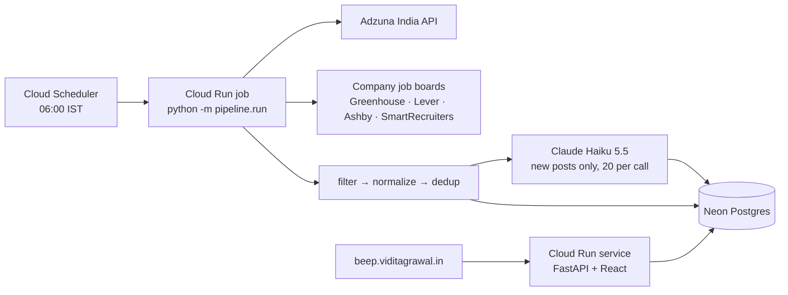

# Fresher Jobs India

**Live:** https://beep.viditagrawal.in · **How it works:** https://beep.viditagrawal.in/about

A small daily pipeline that collects fresher jobs and internships in India from public job APIs, removes duplicates, uses an LLM to tag every post by role and city, and serves a searchable page. It refreshes itself every morning at 06:00 IST.

| | |
|---|---|
| Live fresher posts | see the site header (changes daily) |
| Role tag accuracy, 50 hand-checked posts | see [docs/EVAL.md](docs/EVAL.md) |
| City tag accuracy | see [docs/EVAL.md](docs/EVAL.md) |
| LLM cost per 1,000 posts | see [docs/EVAL.md](docs/EVAL.md) |
| What broke and how it was fixed | [docs/BUILD_LOG.md](docs/BUILD_LOG.md) |

## Architecture



One Docker image, two entrypoints: the web service (`uvicorn api.main:app`) and the daily job (`python -m pipeline.run`).

**A run, step by step** ([pipeline/run.py](pipeline/run.py)):

1. **Fetch.** All sources in parallel, each with its own rate limit and retries. One failing source doesn't stop the run; it's recorded and the run is marked `partial`.
2. **Filter.** Cheap rules drop non-India posts and clearly senior titles before anything costs money ([pipeline/filters.py](pipeline/filters.py)).
3. **Normalize.** HTML → text, tracking params stripped from URLs, company names and city spellings normalized ([pipeline/normalize.py](pipeline/normalize.py)).
4. **Upsert.** On `(source, source_id)`. If a post's text changed, its tags are cleared so it gets re-tagged.
5. **Dedup.** Same URL, same company+title+city, or near-identical titles at the same company and city, merged with union-find. Copies are *marked*, not deleted, and the company's own posting beats an aggregator's ([pipeline/dedup.py](pipeline/dedup.py)).
6. **Tag.** Only untagged, non-duplicate posts go to the LLM. 20 posts per request, and output is constrained to a JSON schema built from [core/taxonomy.py](core/taxonomy.py). Every call's token usage is logged to `llm_calls` ([pipeline/tagger.py](pipeline/tagger.py), [prompt](pipeline/prompts/tagger_v1.md)).
7. **Expire.** Posts that disappear from a (healthy) source for 7 days are hidden, and so are aggregator posts older than 45 days.

## Decisions

- **Only sources whose terms allow it:** official APIs and companies' own public job boards. No scraping of LinkedIn, Naukri, Indeed or Internshala. [docs/SOURCES.md](docs/SOURCES.md)
- **Rules for the obvious, LLM for judgement.** Keywords can't tell "Associate" (fresher) from "Associate Director". So rules only remove clear cases, and the LLM decides `is_fresher` from the description.
- **Dedup before tagging.** We never pay to tag a duplicate, and re-runs only tag new posts, so the daily cost scales with *new* posts, not total.
- **Batching + structured outputs.** The ~2k-token system prompt is paid once per 20 posts. The schema makes invalid roles/cities impossible, and ids are checked so a skipped or invented id can't attach tags to the wrong post.
- **Tags in JSONB.** Adding a tag (e.g. stipend, skills) is a schema + prompt change and a `--retag`, with no migration.
- **Postgres full-text + trigram search** instead of Elastic/Algolia. At a few thousand rows it's milliseconds, and it's one less system.
- **Cloud Run job + Scheduler** instead of an always-on worker. It runs ~5 minutes a day and costs nothing the rest of the time.
- **Short-lived DB connections.** Neon scales to zero and drops idle connections (see build log #4).

## Run locally

```bash
python -m venv .venv && .venv/Scripts/activate      # Windows; use .venv/bin/activate elsewhere
pip install -r requirements-dev.txt
cp .env.example .env                                  # fill in keys; DB URLs can go in .env.local
python -m pipeline.migrate
python -m pipeline.run --dry-run                      # fetch + normalize only
python -m pipeline.run                                # full run
uvicorn api.main:app --reload                         # API on :8000
cd web && npm install && npm run dev                  # site on :5173 (proxies /api)
pytest -q
```

## Accuracy and cost

```bash
python -m eval.sample                                 # pick 50 posts -> eval/data/eval50_labels.xlsx (blind)
python -m eval.score --compare claude-sonnet-5-5      # after labelling
python -m eval.export_sheet                           # working sheet for the submission
```

## Deploy (GCP)

```bash
export PROJECT_ID=...
./infra/deploy.sh setup      # APIs, Artifact Registry, service accounts (once)
./infra/deploy.sh secrets    # .env / .env.local -> Secret Manager
./infra/deploy.sh all        # build, deploy service + job, create the 06:00 IST schedule
./infra/deploy.sh domain     # map beep.viditagrawal.in
```

Region is `asia-southeast1`, because Cloud Run domain mapping isn't available in `asia-south1` (Mumbai).

## Layout

```
core/       config, DB helpers, taxonomy (roles + cities), shared models
pipeline/   sources/, filters, normalize, dedup, tagger, run (the daily job)
api/        FastAPI app + SQL
web/        React + Vite + Tailwind
eval/       sampling, scoring, sheet export
db/         schema.sql
infra/      Dockerfile, Cloud Build, deploy script
docs/       build log, sources, eval
```

## What I'd do next

- More direct sources: there are many more Indian companies on these ATS platforms, and a slug-discovery script would find them.
- Embedding-based dedup for reposts whose titles differ a lot ("SDE-1" vs "Software Engineer, New Grad").
- Use the Batch API for tagging (50% cheaper; the daily job isn't latency-sensitive).
- Saved searches with daily email/WhatsApp alerts. That's the feature students would actually come back for.
